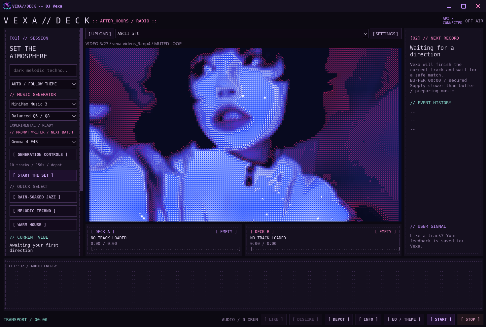
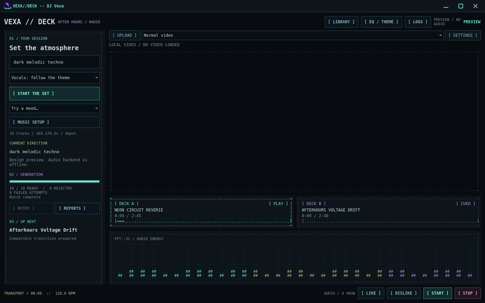
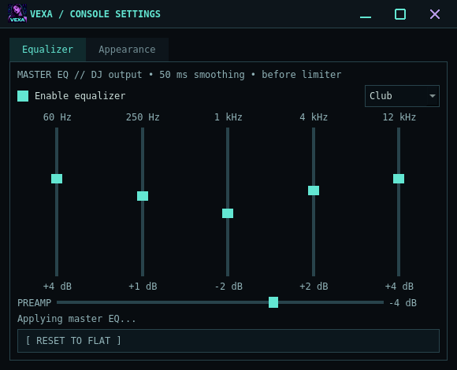
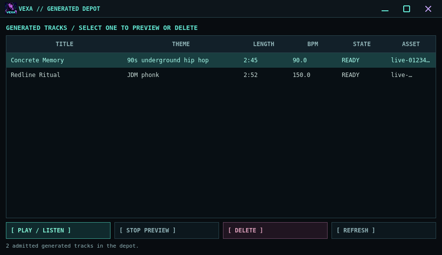
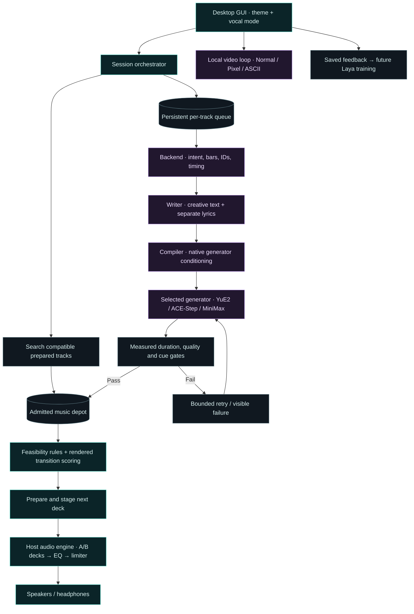
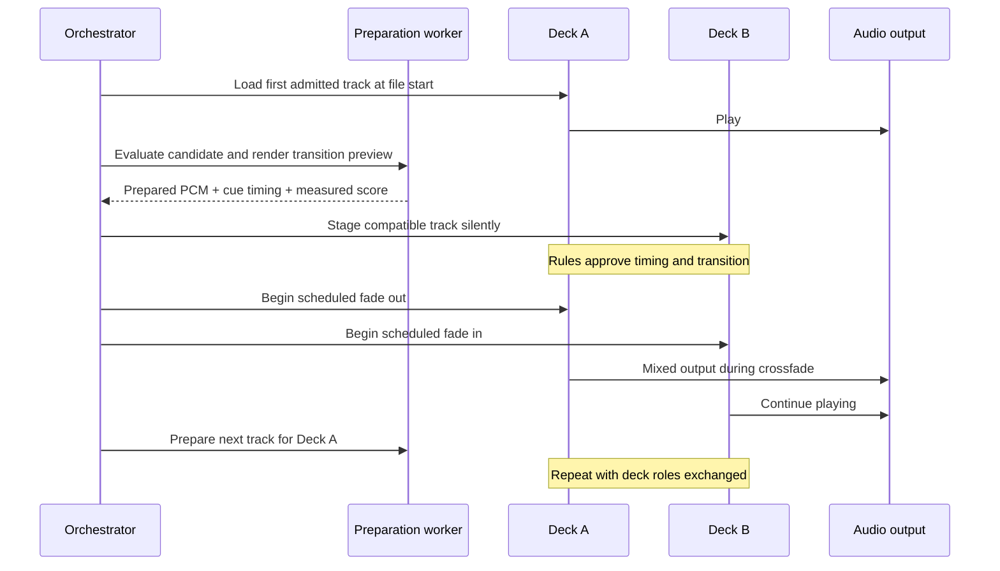
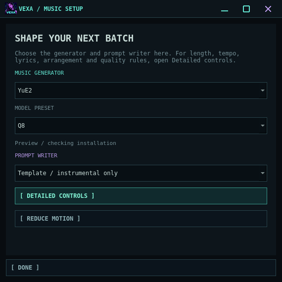
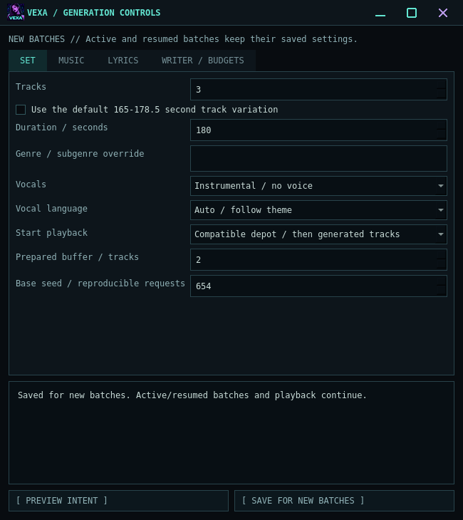
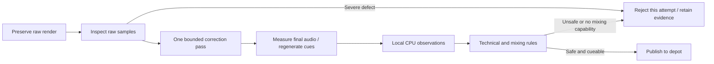
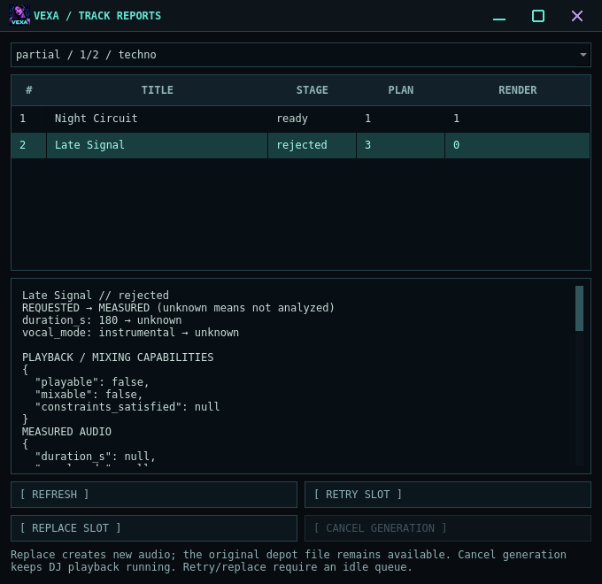

<div align="center">
  

# VEXA//DECK

**Your atmosphere. Vexa's next set.**

An open-source, AI-assisted DJ that mixes prepared music and generates themed tracks in the background.


[](LICENSE)

[Features](#-at-a-glance) · [Screenshots](#-desktop-preview) · [Architecture](#-how-a-set-is-built) · [Install](#install-on-linux--wayland) · [Develop](#development-quick-start)

</div>

VEXA//DECK is a desktop music system with a dark ASCII cyberpunk interface.
You describe an atmosphere — *"a quiet rain-soaked jazz bar"*, *"warm house
that becomes more energetic"* — and it builds a continuous set from prepared musical assets.

## 🎛️ At a glance

| | Feature | What you control |
|---|---|---|
| 🌒 | **Theme-driven sets** | Describe a genre, era or atmosphere; shift the vibe during a set. |
| 🎵 | **Local music generation** | Selectable generators render named ten-track batches with vocal/instrumental modes. |
| 🔀 | **Continuous two-deck mixing** | Measured cues, prepared transitions and rules schedule Deck A/B. |
| 🗃️ | **Music depot** | Browse titles, listen to tracks and delete unused entries. |
| 🎚️ | **Five-band EQ** | Adjust bands, preamp and presets with smoothed changes. |
| 📺 | **Looping video** | Upload local videos; choose Normal, Pixel art or ASCII art and tune effects live. |
| 💠 | **Cyberpunk console** | Four color themes, audio spectrum, custom window controls and compact layouts. |
| 🧭 | **Focused controls** | Session and playback controls up front; models, writer and detailed options in Music setup. |
| 💬 | **Listener feedback** | Save likes/dislikes for future Laya training; playback currently follows rules. |

## 🖥️ Desktop preview

### ASCII video / neon violet



*User screenshot of the earlier three-column layout: looping ASCII video, neon violet console,
generator and writer selectors, and A/B decks. Playback is off air in this capture.*

### Current layout



*Updated two-column layout with sample track data; no audio is playing. Music setup holds
the detailed options, while session progress and playback controls stay in the main view.
The center stays blank until you upload a video.*

<table>
  <tr>
    <th>🎚️ Master equalizer</th>
    <th>🗃️ Named music depot</th>
  </tr>
  <tr>
    <td></td>
    <td></td>
  </tr>
</table>

*EQ and depot captures use test/preview data. User videos, music and model weights are not bundled.*

## 🧩 How a set is built

### Theme → music → mix



Text planning and generation share the **RTX 5060 Ti** through a GPU lock. Generation,
analysis and transition preparation run in separate workers; the host audio callback consumes
prepared PCM. Uploaded videos stay muted. With no compatible depot track, the set waits for
its first admitted render. Failed quality/cue checks retry within the batch's attempt limit;
missing components and setup errors stop generation with a visible reason.

### Continuous deck handoff



The audio engine owns the fade clock and gain envelope. The diagram shows control events;
actual audio runs in one mixer callback. Next-track preparation continues while the current
track plays. Likes/dislikes are recorded for later training and do not change live policy yet.

#### Buffer forecasts and safe waiting

The footer **START** button beside **STOP** starts a set when idle. If a set has finished
its current track and is waiting in silence, **START** plays the next unplayed, verified
track from its active generation batch from the beginning, at that track's measured tempo.
The generation batch continues. No outgoing key/tempo match is needed after the gap;
ordinary overlapping transitions retain their compatibility checks. If no generated track
is ready, the app asks you to wait and press **START** again. The recovery action is also
available as `POST /live/start`.

**STOP** silences both decks and resets playback to the beginning without cancelling
music generation. Newly generated tracks stay in the depot; playback remains stopped
until you press **START**. START restarts the current track, or plays a verified generated
track if playback had not begun yet. Use **Cancel generation** separately to stop its worker.

`GET /live` includes `continuity`: secured playback seconds, conditional depot inventory,
measured supply/preparation latency, startup ETA, preparation deadlines and misses. Each
four-second overlap is subtracted, and duplicate content/families are excluded. Conditional
inventory is an estimate; a whole candidate chain has not yet been rendered.

Preparation publishes the first measured compatible candidate, considers at most three,
and cancels work after its deadline or a theme/EQ change. Rules and DSP identity are checked
again before committing. Transition previews use the actual playback mixer, gains, EQ and
limiter, with floating-point WAV output. The first track starts at zero; subsequent mixes
use measured entry cues. Changed tempo/PCM caches are rejected or rebuilt using integrity
receipts. Preview and live filter history can differ; parity tests use matched initial state,
and live cue commits allow only a bounded callback/scheduler timing tolerance.

Cue analysis prefers a late exit but can use an earlier measured exit for a long rhythmic
release/outro: the search is bounded to the final quarter of the track, capped at 45 seconds.
The four-second fade and a two-second margin must remain inside regular measured beats with
audible onset support. A beatless tail does not itself require another full render. Truly
unsupported exits remain rejected. Cue-failure retries persist a correction to keep the
established rhythm through the DJ outro, including when retrying a saved older batch; they
retain the requested duration, genre, lyrics and attempt limits. Existing hash-bound v2 cue
reports remain readable alongside newly written v3 reports.

**MiniMax render speed** in generation settings controls denoising separately from the
model weight preset: **Fast = 12 steps**, **Balanced = 20**, **Quality = 30**. New settings
default to Balanced; older saved plans without this field retain their original 30 steps.
Fast is experimental and may affect sound quality. All profiles generate the requested
full-length track and keep the same technical/cue admission gates. The choice is saved in
each batch and has its own latency history, so a speed change does not reuse a slower
profile's ETA. YuE2 and ACE-Step ignore this MiniMax setting.

Recent 165-second MiniMax tracks on RTX 5060 Ti spent about 162 seconds in autoregressive
sampling and 265 seconds in 30-step denoising, before analysis and planning. Fewer steps
address the denoising cost; they do not guarantee generation faster than playback. For a
set without generation pauses, choose **Wait for complete generated batch**. Compatible
depot playback can cover generation when enough matching tracks already exist; a small
startup buffer can still run out.

To compare denoising on a saved full-length song without resampling its music tokens:

```bash
.venv/bin/python tools/benchmark_minimax_speed.py assets/library/TRACK.wav \
  --speed fast --out var/reports/minimax-speed
```

This tool needs the track's `.replay.json`, `.brief.json` and native `.render.log`. It queues
on the shared GPU lock, uses an isolated output and runs full admission. Replay wall time
is not fresh-generation wall time: the report labels the estimated fresh-render savings
separately. New native render receipts include measured AR, denoising, VAE and total timing.

Tracks **never repeat within a set**. If no compatible incoming track is ready, Vexa finishes
the current file and shows **WAITING**. A later admitted match resumes from its beginning.
No unapproved fallback loop replaces it. Known inventory shortfalls request replenishment
before the buffer expires; failed batches remain available for explicit retry.

Supply history is stored in `var/generation/latency.sqlite3`, separated by generator, preset,
duration, vocal/tempo settings and writer. It includes planning, rendering, analysis and
rejected-slot cost. Cold-start ETA is unknown, small samples are provisional, and an overdue
estimate becomes unknown again. Generated-buffer startup increases its waiting target when
measured latency requires more supply. This cannot make a slow generator produce music faster.

## The one rule everything is built around

> Audio continuity is the highest priority. A model timeout or failed generation must not
> interrupt the stream.

Every architectural decision follows from this. Models make **bounded** decisions: the playback
engine, beat alignment, gain limits and transition deadlines stay deterministic. A selector picks
an action from a menu that has already been validated; it can never write a DSP command. If any
model is slow, dead, or wrong, the set keeps playing.

## Current state

**Host backend and Linux desktop app.** Versioned contracts, measured cue reports, theme retrieval,
YuE2 generation, rendered transition scoring, continuous two-deck playback, and a cyberpunk Qt
console with deck state and live audio spectrum.

| Component | Status |
|---|---|
| `packages/contracts` | 24 versioned schemas, JSON Schema export, invariants enforced structurally |
| `services/orchestrator` | Feasibility filter, rule policy, beat-clock scheduler, request state machine, HTTP API |
| `services/planner` | OpenAI-compatible client + local rule-based fallback |
| `services/laya` | Dataset schema, family-level splits, eval/training converters, bounded-choice adapter, RLCD fine-tune loop |
| `workers/yue2` | BS.1770-4 loudness, true peak, tempo/key/structure analysis, readiness gates |
| `services/audio` | **Two decks, crossfade, master limiter.** Runs on the host; nothing plays without it |

**The audio engine plays.** 7787 callbacks over 90 s with **zero underruns**, worst callback
0.61 ms of an 11.6 ms budget. Run `uv run --no-sync python tools/audio_smoke.py --seconds 1800`
for the full 30-minute soak.

**The Laya fine-tune pipeline is verified running on the RTX 5060 Ti.** Loss 0.9210 → 0.5409,
peak VRAM 7.81 GiB of 15.5 GiB. Those numbers came from rule-generated labels and prove the
machinery, not the quality — real labels come from A/B human review.

Phase gates, hardware allocation, and the reasoning behind each choice are in
**[`vexa-deck-docs/PLAN.md`](vexa-deck-docs/PLAN.md)**. Fine-tuning is in
**[`vexa-deck-docs/FINETUNE.md`](vexa-deck-docs/FINETUNE.md)**.

## Install on Linux / Wayland

The release is a **Linux source distribution with a per-user installer**. It installs a Python
runtime and locked dependencies, a menu entry, icons and the `vexa-deck` command. Internet access
is needed for dependency/model downloads. Music, user videos and model weights are separate.
Windows/macOS binaries and an offline AppImage are not provided in this release.

### Requirements

- Linux desktop with Wayland (X11 also supported by Qt), system audio through PortAudio,
  FFmpeg and Git. The installer manages Python 3.12 through
  [uv](https://docs.astral.sh/uv/getting-started/installation/).
- Qt Widgets, Multimedia and WebEngine: the default installer uses the tested **PySide6 6.11.2**
  wheels. [Qt's installation documentation](https://doc.qt.io/qtforpython-6/gettingstarted.html)
  describes the bundled wheels and system prerequisites. System Qt is an optional alternative.
- Local generation: NVIDIA driver, **RTX 5060 Ti / 16 GB** as the primary GPU, a CUDA toolkit
  supporting the GPU (12.8 or newer for Blackwell), C/C++ build tools, CMake, and
  [Ollama](https://ollama.com/download/linux). Leave enough disk space for the Python environment,
  approximately 14 GB of music/text weights, and your growing depot; 25+ GB free is a practical start.
  GUI/video playback and prepared audio do not require generation weights.

Print the system package command for Debian/Ubuntu, Arch or Fedora. Add `--apply` to execute it:

```bash
bash scripts/install-system-deps.sh --with-build-tools
bash scripts/install-system-deps.sh --with-build-tools --apply
```

This helper installs libraries/build tools; install the NVIDIA driver, CUDA toolkit, uv and Ollama
separately using their official instructions. It does not change GPU drivers.

### Install from a checkout or release archive

From a checkout, run the installer directly. From a release, first verify and extract the files:

```bash
sha256sum -c vexa-deck-0.1.0-linux.tar.gz.sha256
tar -xzf vexa-deck-0.1.0-linux.tar.gz
cd vexa-deck-0.1.0-linux
```

Then:

```bash
bash scripts/install.sh --dry-run   # preview paths and dependencies
bash scripts/install.sh
~/.local/bin/vexa-deck --preview   # inspect the GUI without opening audio
```

Default app location is `$XDG_DATA_HOME/vexa-deck` or `~/.local/share/vexa-deck`. The menu entry
and icons live under `$XDG_DATA_HOME`; the command uses `$XDG_BIN_HOME` or `~/.local/bin`.
Add the command directory to `PATH` if it is not already there. This is a user installation;
do not run the app installer with sudo.

Installer options:

| Option | Effect |
|---|---|
| `--prefix /absolute/path` | Use another app directory; updates require the same prefix. |
| `--data-home /path --bin-home /path` | Override shortcut/icon and command destinations. |
| `--system-qt` | Use `/usr/bin/python3` with distribution PySide6, Multimedia and WebEngine. |
| `--minimal` | Install backend/GUI without Torch and local text-planner dependencies. |
| `--skip-deps` | Copy files and install shortcuts only; no downloads. Supply runtime dependencies separately. |
| `--dry-run` | Display actions without creating files or downloading anything. |

The installer creates an empty `vexa-videos/` folder and an empty music depot. The GUI upload
picker references videos at their original paths; keeping them in `vexa-videos/` is optional.
No personal media is copied out of the checkout or included in the release.

### Enable local music generation

After installing the CUDA toolkit and Ollama, run from the installed app directory:

```bash
cd ~/.local/share/vexa-deck  # use your custom/XDG prefix if different
bash scripts/install-models.sh
.venv/bin/python tools/doctor.py --generation
~/.local/bin/vexa-deck
```

The model installer builds pinned `yue2.cpp` CUDA source and downloads only the Q8_0 backbone
and F32 VAE, then installs the ACE-Step text planner and private Gemma writer. Downloads total
multiple gigabytes and are governed by the model terms. It does not download future-work models,
Laya training weights or the optional SheetSage transcriber. YuE2 weights are CC BY-NC 4.0;
[native backend](https://github.com/ServeurpersoCom/yue2.cpp) and
[model download source](https://huggingface.co/Serveurperso/YuE2-GGUF).

Install individual components with `scripts/install-models.sh yue2`, `planner`, or `writer`.
Use `.venv/bin/python tools/install_yue2.py --dry-run` to inspect native build/download settings.
Existing YuE2 checkouts with another revision or local changes are preserved and require manual
review or a separate `--directory`. The private Ollama model cache leaves your system service intact.

The launcher reads the installed `.env` as data; explicit exported environment variables take
precedence. Set `VEXA_YUE_BINARY`, `VEXA_YUE_MODEL`, `VEXA_YUE_VAE` or `VEXA_ACE_MODEL` there to use
existing models elsewhere. After setup, enter a vibe, select the vocal mode, and start the set.
A fresh installation waits for the first admitted generated track because its depot is empty.

### Updates, diagnostics and uninstall

Run a newer extracted release's `scripts/install.sh` with the same prefix and shortcut paths.
App source is updated; `.env`, `var/`, models, generated tracks and local videos are retained.
Use the installer for updates rather than extracting release files over the installed directory.

```bash
# From the installed directory; checks do not play audio or download files:
.venv/bin/python tools/doctor.py
.venv/bin/python tools/doctor.py --generation --json
bash scripts/uninstall.sh --dry-run
bash scripts/uninstall.sh
```

For a custom install, pass `--prefix /your/app/path` to uninstall. It removes only unchanged menu,
command and icon files recorded by this installer. App files and user data remain under the
prefix so your tracks and weights can be retained; remove that directory yourself when desired.
Logs and diagnostics are in `var/logs/` and the GUI's **[ LOGS ]** panel.

### Build a release

```bash
bash scripts/package.sh
# Optional reproducible timestamp:
SOURCE_DATE_EPOCH=0 bash scripts/package.sh --output dist
```

Outputs `dist/vexa-deck-0.1.0-linux.tar.gz` and its SHA-256 checksum. The archive contains source,
locked dependency metadata, Qt/video assets, installers, tests, docs and license notices, plus a
per-file inventory. It excludes `.git`, `.env`, private tool settings, virtual environments,
weights, `vexa-videos/`, generated audio, datasets and runtime state. Unexpected large source files
or symlinks fail the build. `.gitignore` and `.dockerignore` also keep those artifacts out of commits
and container contexts. `.gitignore` does not untrack files that were committed previously.

## Development quick start

```bash
uv sync --locked --extra core --extra desktop --extra local-planner
uv run --no-sync pytest
uv run --no-sync ruff check .
bash apps/desktop/run.sh
```

### Running the stack

```bash
cp .env.example .env      # every value is optional
docker compose up -d
curl localhost:8080/health
curl localhost:8081/health
```

The continuous DJ runner must run **on the host**, with access to the audio device and YuE2 model
files. The container stack still exposes the control services without host audio. The host runner
uses the same orchestrator API and starts with `VEXA_LIVE=1` by default.

### Start a continuous set on the host

```bash
uv run --no-sync python tools/extract_cues.py
VEXA_LIBRARY=assets/library uv run --no-sync python -m vexa_orchestrator
curl -X POST localhost:8000/sessions -H 'Content-Type: application/json' \
  -d '{"theme":"dark melodic techno"}'
curl localhost:8000/live
```

The runner searches admitted depot tracks for the theme and starts a compatible full-length one
immediately. The live host excludes legacy 45-second depot renders by default
(`VEXA_MIN_TRACK_DURATION_S=148`); they remain available for analysis and other tooling.
It also queues ten distinct tracks through the selected generator, targeting 165 to 178.5 seconds.
YuE2's semantic minimum is set for each render so an early end token cannot produce a short
track. Each render must pass duration, audio quality, and cue gates before it enters the depot.
Each of the ten slots gets at most three planning attempts and three rendering attempts.
A rejected slot does not consume the other slots’ retry budgets; later slots continue.
If the depot has no cueable match, playback waits for the first admitted asset. `GET /live`
reports the current batch number, ready count, failures, prompt origin, and both deck states.
Playback begins at the start of the file; measured cues control the transition timing. The
next track is staged silently on the other deck before the crossfade.

### Recoverable generation v2

The live path now builds a typed `ThemeSpec` and `TrackPlan` **before** asking the writer.
The backend owns duration, tempo targets, bar allocations, section IDs/order and continuous
timing. The writer supplies a title, instrument roles and descriptions for those IDs.
Vocals use a second request for original lyric lines; instrumental tracks skip that request.
MiniMax captions and generator lyric tags are compiled from accepted fields. The writer
never supplies the final clock ranges or native caption format.

- Each slot has independent planning and rendering retries. A failed slot leaves a partial
  batch and a readable reason, while later slots keep progressing.
- Accepted creative drafts survive a failed lyric request. Validation feedback accompanies
  the next attempt. Local output schemas enforce empty instrumental sections and developed
  rap verses. Unknown IDs, conflicting vocal instructions and malformed fields are rejected.
- SQLite jobs live at `var/generation/jobs.sqlite3` with the default preview directory.
  Creative caches live beside the database under `drafts/`; request/validation diagnostics
  are saved in `var/plans/raw/`, worker logs in `var/logs/`.
- **RESUME / RETRY BATCH** restores an unfinished batch after restart and retries rejected
  slots. It reuses accepted plans and published renders whose audio/cue hashes still match.
  Deleted or changed ready tracks require an explicit retry. The generator, preset and writer
  settings are captured for each batch; resuming keeps that snapshot.
- Generation, mastering and cue analysis remain outside the audio interpreter. The GPU lock
  serializes heavy jobs on the RTX 5060 Ti. The private writer exits before music rendering;
  resuming a batch does not reset the current decks.

| API | Purpose |
| --- | --- |
| `GET /generation/batches` | Saved batch summaries and per-track progress |
| `GET /generation/batches/{id}` | One batch's titles, stages, attempts and errors |
| `POST /generation/batches/{id}/resume` | Resume; send `{"retry_failed":true}` to retry rejected slots |
| `GET /generation/writers` | Installed writer candidates and the selected profile |
| `POST /generation/writer` | Save a validated writer profile for future batches |
| `GET /live` | Current stage, ready/rejected counts, failed attempts and deck status |

### Generation controls and track reports

Open **MUSIC SETUP → DETAILED CONTROLS** before starting or shifting a theme.
Settings persist at `var/config/generation-controls.json`. New batches capture the
controls, writer and generator; active and resumed batches retain their saved snapshot.
The GUI previews resolved intent before submitting a new theme. Overrides are also
listed by **PREVIEW INTENT** in the settings window.





| Tab | Available controls |
| --- | --- |
| **SET** | 1–10 tracks; fixed 150–180 second duration or default duration variation; genre/subgenre; Auto, Instrumental, Sung or Rap; vocal language; startup policy; reproducible base seed |
| **MUSIC** | Tempo target or theme default; optional strict measured tempo admission; DJ, Steady, Build or Wind Down energy; era/texture, groove/density and instrument inclusion/exclusion hints |
| **LYRICS** | Topic override; narrator/delivery direction; optional custom original lyrics |
| **WRITER / BUDGETS** | Context and output tokens; separate music/lyric creativity; per-slot planning/rendering attempts and deadlines |

Startup policies apply when beginning a set:

- **Compatible depot:** begin with a cueable depot match, or the first admitted generated track.
- **Generated buffer:** wait for at least the configured admitted-track count; measured supply
  latency can increase the target, capped at batch size.
- **Complete batch:** wait until every slot is admitted. A partial batch remains waiting;
  inspect its reports and retry the failed slots.

Changing the theme while music is playing keeps the current deck running. The new startup
policy does not interrupt an already playing set. Buffer policy counts admitted files;
transition preparation remains governed by measured cue/compatibility rules.

Custom lyrics use `[Verse 1]`, `[Refrain]` (or `[Chorus]`) and `[Verse 2]`. A single
refrain is expanded into both refrain sections. Rap requires two distinct 16-line verses
and a four-line refrain; intro, outro and instrumental break remain empty. Custom lyrics
skip the lyric-writing request and can be used with the template writer. Instrumental
mode rejects custom lyrics rather than silently discarding them.

Instrument, texture, groove, genre, language and energy controls are **conditioning targets**.
Their audible presence is not verified yet. All models receive the seed and duration;
ACE-Step also receives its native BPM control. Strict tempo admission compares the measured
pulse with the planned target within 3 BPM, accepting half/double-time equivalents. Existing
duration, loudness, audio quality and cue gates stay mandatory. Stem analysis, voice-sample-only
mode and arbitrary arrangement editing are explicitly unavailable in this stage.

Use **TRACK REPORTS** to inspect each slot's requested versus measured values, quality
gates, attempt history, plan and writer details. Genre, vocal presence, language and energy
are shown as **unknown measurements**, even if the depot has generation-intent tags.
Reports also show raw/final evidence, corrections and separate playable/mixable flags.
Batch warnings are displayed separately from app failures.

- **Cancel generation** interrupts its worker and leaves playback running.
- **Retry slot** reuses an accepted plan and creative cache. Other admitted slots are recovered.
- **Replace slot** plans and renders a new variation with new seeds and a new file identity.
  The original depot audio remains available, including audio already loaded on a deck.
- Retry and replace require an idle generation queue. **RESUME / RETRY BATCH** remains
  available for recovery after restart.

| API | Purpose |
| --- | --- |
| `GET /generation/settings` | Saved controls and capabilities of the selected generator |
| `POST /generation/settings` | Save validated controls for future batches |
| `POST /generation/settings/validate` | Validate controls without saving or loading a model |
| `POST /generation/preview` | Resolve a theme and optional `generation_settings`; no generation |
| `POST /generation/cancel` | Cancel the generation worker independently of playback |
| `GET /generation/batches/{id}/tracks/{slot}` | Track report; slots start at 1 |
| `POST /generation/batches/{id}/tracks/{slot}/retry` | Retry a rejected or unavailable slot |
| `POST /generation/batches/{id}/tracks/{slot}/replace` | Create a replacement variation |

Session creation and theme changes accept an optional `generation_settings` object.
An explicit legacy `instrumental` flag overrides the saved vocal mode for that request.
Seeds make the requested variation traceable; model/runtime changes and cloud inference
may prevent identical output. Planning retries and render retries use separately recorded
seed variations. The original 90-plan writer benchmark remains a frozen earlier comparison.

### Audio evidence and bounded correction

New renders pass through a shared ingestion pipeline for YuE2, ACE-Step and MiniMax:



- `<track>.raw.wav` preserves the original output. `<track>.evidence.json` records
  raw/final hashes, metrics, corrections, admission decisions and analyzer status.
  Small `.progress.json` files expose raw-check/correction/analysis stages to the GUI.
- Raw checks catch unreadable/nonfinite audio, wrong duration, silence, severe source
  clipping, excessive DC offset and internal digital-silence gaps. These are provisional
  technical limits, recorded with each report; they are not genre-calibrated judgments.
- One correction pass can duplicate mono into stereo, normalize unsupported sample rates
  to 48 kHz, remove small DC offsets, fade exposed boundaries over 5 ms and master levels.
  Final audio is remeasured. Duration is never padded, genre is never “repaired” by mastering,
  and aggressive denoising, voice removal, tempo forcing and key shifting stay disabled.
- Loudness sums independent channel powers; peak measurement uses fourfold polyphase
  resampling across channels. Mastering applies gain and soft limiting, then checks
  intersample headroom. Opposite-phase stereo cannot conceal clipping or silence.
- Reports distinguish **technically playable**, **mixable** and **constraint evidence**.
  Healthy free-time audio can be playable while failing beat-mixing admission. It stays
  preserved for review; automatic free-time level fades are not implemented yet.
- Requested mood, energy and instrumental mode live under `intent_*` tags. Existing
  generated depot tags are migrated in memory. Measured spectral balance and level curves
  remain separate from subjective energy or certified genre. Attempt evidence survives
  retry/replacement; changed report hashes are flagged instead of trusted.



**Optional local observations.** The [CLAP checkpoint](https://huggingface.co/laion/clap-htsat-unfused)
supports audio/text comparisons. Vexa uses three eight-second windows across intro, body and
outro, stores cosine rankings, vocal-versus-instrumental margins and a cached embedding, and
records the model weight hashes. Inference runs on CPU inside the offline worker. Scores
are not probabilities; they do not certify Memphis phonk, vocal occupancy or lyric language.
Missing/failed analyzers report `unavailable` with unknown values and do not invalidate an
otherwise safe render. Semantic observations cannot reject tracks until independently calibrated.

```bash
uv sync --extra core --extra desktop --extra audio-observers
.venv/bin/python tools/install_clap_audio.py
```

The installer pins a model revision and writes a hash receipt under the ignored
`models/audio-observers/clap-htsat-unfused` folder. That directory is the default observer
location; `VEXA_CLAP_MODEL` can select another local checkpoint or be set empty to disable it.
Inference never downloads missing weights. Model weights remain excluded from release archives.

Audit existing tracks on protected copies, without altering the depot or playing audio:

```bash
.venv/bin/python tools/check_audio_evidence.py path/to/track.wav --theme 'Memphis phonk'
```

Audit reports go to `var/reports/audio-evidence/`. Existing ACE-Step and MiniMax copies
passed technical/cue admission and real CPU CLAP observation in the P5 check; final peaks
measured −1.51 dBTP. This verifies ingestion, not listener preference or exact genre accuracy.

For human vocal annotations, use JSON rows containing `evidence_path`, boolean
`vocals_present` and `split` (`calibration` or `validation`), then run:

```bash
.venv/bin/python tools/calibrate_audio_observers.py annotations.json
```

Evaluation requires at least 20 independent vocal and 20 instrumental draft families in **each**
split, one pinned model identity and no duplicated audio hashes. It reports held-out false positives
and recall. It never enables an admission gate automatically. No annotated vocal calibration
corpus is bundled. Automatic stem separation, repetition detection, full vocal occupancy and
genre-specific quality profiles remain follow-up work. Continuity forecasting and playback
load measurements are implemented. P7 listening/evaluation tooling is available; human review
and held-out observer calibration remain pending. Laya fine-tuning remains deferred.

### Prompt writers and measured selection

Use **PROMPT WRITER / NEXT BATCH** in the sidebar to choose Gemma, Qwen, Nemotron cloud
or an instrumental template. The selected profile persists in `var/config/writer.json`
and takes precedence over environment defaults. An active or resumed batch keeps its saved
writer; changing the selector affects future batches. The GUI waits for the setting to be
acknowledged before accepting a new theme.

The installed **Gemma `gemma4:e4b`** remains the local default after a 90-plan comparison
on the RTX 5060 Ti (2026-10-09): ten themes, three variations each, up to three planning
attempts per case. Qwen is available as an experimental alternative.

| Writer | Accepted / 30 | First attempt / 30 | Median plan | P95 plan | Peak local device memory |
| --- | --- | --- | --- | --- | --- |
| Gemma `gemma4:e4b` | **30** | **30** | **5.7 s** | 20.0 s | 5,975 MiB |
| Qwen `qwen3.5:9b` | 28 | 28 | 10.2 s | 46.9 s | 7,706 MiB |
| Nemotron `nemotron-3-super:cloud` | 27 | 24 | 14.4 s | 33.3 s | Cloud model memory unmeasured |

Times include retries and failures. Local memory is total device use, including the desktop,
sampled every 0.5 seconds. Requests used an 8,192-token context and 4,000-token output
budget. Qwen rejected two Turkish rap cases for repeated verse lines; Nemotron rejected
three instrumental Memphis cases for vocal material. These are **prompt checks**, with no
music rendered: passing does not certify genre accuracy or natural lyric phrasing.
The saved comparison precedes the subsequent retry seed and field-feedback improvements.

Reproduce the comparison or inspect its raw per-case plans and request telemetry:

```bash
.venv/bin/python tools/benchmark_writers.py --models gemma4:e4b qwen3.5:9b --include-cloud \
  --output var/reports/writer-benchmark
.venv/bin/python tools/summarize_writer_benchmark.py var/reports/writer-benchmark
# This installation's saved comparison: var/reports/writer-benchmark-final/comparison.json
```

Install another local writer into the private depot, then select it in the GUI:

```bash
.venv/bin/python tools/install_local_lyric_writer.py --model qwen3.5:9b
# Optional environment defaults, used before a GUI profile is saved:
# VEXA_WRITER_MODE=local
# VEXA_WRITER_MODEL=qwen3.5:9b
```

`VEXA_WRITER_MODE=remote` uses `VEXA_LLM_PROVIDER`, `VEXA_LLM_BASE_URL` and
`VEXA_LLM_MODEL` (the existing Nemotron cloud route). `VEXA_WRITER_MODEL` and
`VEXA_WRITER_URL` optionally override the model and endpoint. `template` produces
instrumental briefs without an LLM. With the new variables blank, existing
`VEXA_MUSIC_PLANNER`, `VEXA_ACE_WRITER_MODEL` and remote configuration remain compatible.
Cloud tags require remote mode. Local models use `models/ollama-writer/` and a private
Ollama process unless an explicit writer URL is configured.

Profiles expose `context_length`, `max_tokens`, `creativity`, `lyric_creativity` and `seed`
through `POST /generation/writer`. Environment defaults are `VEXA_WRITER_CONTEXT=8192`,
`VEXA_WRITER_MAX_TOKENS=4000`, `VEXA_WRITER_CREATIVITY=0.35` and
`VEXA_WRITER_LYRIC_CREATIVITY=0.6`. Local manifests are pinned by digest, and a changed
model pauses a saved batch instead of silently using different weights. Cloud manifest
digests identify the route; they cannot pin the provider's remotely served weights.
Capability checks choose local JSON schemas or cloud JSON text and apply thinking controls
only when supported. Diagnostics include token counts, request timing and requested retry seed.

Rejected fields receive their validation reason and offending field names. Retries vary
the seed reproducibly while retaining an accepted creative draft. Negative directions such
as "avoiding vocals" are distinguished from positive vocal instructions. English topic
matching remains a lexical check; translated lyrics have explicitly unknown topic evidence.

Inspect real per-track plans without rendering audio:

```bash
.venv/bin/python tools/check_generation_v2.py --theme "dark melodic techno instrumental" --count 10
.venv/bin/python tools/check_generation_v2.py --theme "90s underground rap in English" --count 1
```

The older `plan_theme` tools retain the ACE-Step text planner for offline comparison;
**live v2 bypasses that extra text model for all three music generators**. Existing duration,
mastering, quality and cue admission gates still run on rendered audio. Planned genre, BPM,
energy and vocal mode are targets, not measurements or proof of genre accuracy.
Instrumental sessions exclude depot tracks marked vocal or with unknown intent. API callers
can explicitly set `instrumental: true` or `false` on session creation and theme changes.

P7 now provides a matched rendered-audio evaluation worklist, bounded isolated generation runs,
blind listening bundles and content-bound human scorecards. Human listening, complete matrix
coverage and held-out voice/genre calibration remain pending; no model is promoted automatically.
See [P7 evaluation and rollback](vexa-deck-docs/EVALUATION_P7_2026-10-10.md) for commands and gates.
Laya training remains deferred.

Use `POST /sessions/{id}/theme` with `{"theme":"..."}` to steer the set, `GET /live` to observe
the active and prepared decks, and `POST /sessions/{id}/feedback` with `{"rating":"like"}` or
`{"rating":"dislike"}` to record listener feedback for later Laya training. Feedback does not
control playback yet. `POST /live/stop` closes the host audio device.

### Linux desktop console

Use the installer above, or set up the development checkout with
`uv sync --locked --extra core --extra desktop --extra local-planner` and the model installer.
Launch the checkout with:

```bash
bash apps/desktop/run.sh
```

Install the Linux application-menu launcher and VEXA ASCII portrait icon for your user:

```bash
/usr/bin/python3 tools/install_desktop.py
```

The installer uses `XDG_DATA_HOME` (or `~/.local/share`) and adds a `VEXA//DECK` menu entry.
Its Wayland application ID is `vexa-deck`. Rerun the installer after moving the repository.

On a Wayland session, Qt uses its Wayland platform plugin. The app starts the host audio backend
locally, so the audio device and prepared depot must be available on the host. Enter a theme and
press **Start the Set**. Vexa chooses a compatible prepared track immediately when one is ready;
otherwise she waits for generation and admission. Generation continues in the background
until ten tracks are admitted or 30 attempts have been made. The left panel shows progress,
and the live spectrum measures deck audio outside the audio callback. **Library** lists
admitted generated tracks with Listen and Delete controls. Delete moves a track and its sidecars
into `var/trash` and rejects tracks in use by a deck. **Up next** stays in the session panel.
**Logs** opens session details, recent deck moves and the event log. Like/Dislike and
Start/Stop stay in the footer at every supported window size.
Feedback is saved for later Laya training and does not alter live selection yet.

The launcher writes `var/logs/*-launcher.log`, the backend writes
`var/logs/*-backend.log`, and the GUI writes `var/logs/*-gui.log`. The **Logs** diagnostics window shows
backend events and errors as they arrive. PortAudio output underflows are counted separately
from mixer errors and logged with callback time, device load, and generation state. Playback
uses 2048-frame callbacks with the device's high-latency buffer. CPU helper pools default to
two threads (`VEXA_CPU_THREADS`). Generation, mastering,
librosa cue analysis, decoding, tempo stretching and rendered transition scoring run in
separate low priority processes with one helper thread and two logical CPUs left available
for audio/UI. Prepared PCM is handed back as read-only memory-mapped data and touched before
deck installation. The PCM pointer, position and fade state change together at a callback
boundary. `VEXA_AUDIO_BLOCKSIZE` overrides the default 2048-frame radio buffer. YuE2 stays on
the RTX 5060 Ti. Stop/theme changes terminate generation workers and their renderer children.
Worker logs are retained in `var/logs/offline-*.log`. The master limiter uses a continuous sample
gain envelope with a 250 ms release, avoiding callback-boundary gain resets. Run
`.venv/bin/python tools/check_audio_load.py` for a quiet 14-second device check with two
background CPU workers; its measurements are saved to `var/reports/audio-cpu-load.json`.
This checks CPU contention. Run `.venv/bin/python tools/check_audio_generation.py` during
YuE2 generation for an additional device check that prepares real tracks and loads/fades
both decks; measurements are saved to `var/reports/audio-generation-load.json`. `GET /depot/tracks`,
`GET /depot/tracks/{asset_id}/audio`, and `DELETE /depot/tracks/{asset_id}` expose the same
generated depot controls over the local API.

For a sustained, quiet Wayland/device check with real local writing and MiniMax generation:

```bash
.venv/bin/python tools/check_continuity_load.py --duration 1800 --gui \
  --generator minimax --renders 4 --production-generation \
  --no-steer --theme 'dark warm'
```

The test uses isolated generated files and read-only source depot audio, displays the actual
deck status in a Wayland GUI, and writes callback/deadline/drop deltas, preparation misses,
inventory forecasts and CPU/GPU samples under `var/reports/continuity-load/`. Its generated
tracks remain available there for listening. Quiet playback checks scheduling and device
health; genre quality and audible defects still require listening review. Optional CLAP
work defers while preparation is urgent or callback health is recovering. Preparation workers
have higher CPU priority than background analysis; both reserve two logical CPUs for audio/UI.

This mode exercises the production generation runner and replenishment with a fixed theme.
It needs enough compatible prepared inventory to cover generation latency. Add repeatable
`--seed-library /path/to/prepared/library` options to include other admitted libraries without
modifying them. The report separates device health from uninterrupted music supply:
`health_passed` can be true while `continuous_music_passed` is false when inventory runs out.
Omit `--production-generation --no-steer` for the diagnostic workload with automatic theme
changes and separately managed generation. Tempo/language preference boilerplate is excluded
from depot theme retrieval; explicit genre and playback rules still apply.

The launcher resolves local workspace source directories from the current checkout on each
start, including after the drive changes mount paths. If a direct
`.venv/bin/python -m vexa_orchestrator` invocation reports a missing module after moving the
project, rebuild its
editable installs from the new root:

```bash
uv sync --locked --inexact --extra core --reinstall-package vexa-contracts \
  --reinstall-package vexa-audio --reinstall-package vexa-orchestrator \
  --reinstall-package vexa-planner --reinstall-package vexa-laya \
  --reinstall-package vexa-yue2-worker
```

YuE2 launches also resolve bundled GGML shared libraries from the executable’s current
folder through the subprocess environment. A moved checkout therefore does not depend on
the old absolute library paths embedded at build time. Missing components, GPU setup and
loader failures stop the generation batch immediately; audio quality rejections remain
retryable. The GUI retains the failure reason when a batch cannot finish.

Set `VEXA_API_URL=http://127.0.0.1:8000` to attach to an existing backend instead of starting a
new one. `bash apps/desktop/run.sh --preview` shows a design preview without backend or audio.
The desktop uses a dark terminal console: ASCII panel borders, installed monospace typography,
muted cyan and violet accents, a 32-band character-based spectrum and A/B progress readouts.
The center is a local looping video player that fills its allocated area, with A/B
readouts below it. The window resizes down to 720 × 700 and fits a 1080p half-screen tile.
The main window, music depot and diagnostics use a matching dark title bar with the app icon,
cyan minimize/maximize controls and a violet close control. Drag the title bar to move or tile
the window, double-click it to maximize/restore, and drag an edge or corner to resize.
The two-column layout keeps everyday controls in a compact session panel and gives the video
the remaining width. The A/B decks and spectrum sit together beneath the video. The spectrum
uses a 160-pixel strip (110 pixels in short windows). Below 1000 pixels wide, transport status
and action buttons use separate rows; the sidebar scrolls when needed.
Theme entry remains a native Unicode text field.

| Task | Where to find it |
| --- | --- |
| Start a set or change its direction | Session: vibe input, vocal mode, **Start the Set / Shift the Vibe** |
| Pick a generator, model preset or prompt writer | **Music setup** |
| Track length/count, tempo, lyrics, render speed, admission rules and budgets | **Music setup → Detailed controls** |
| Batch progress, recovery, track quality and generation cancellation | Session progress, **Retry** and **Reports** |
| Listen to or delete generated tracks | **Library** in the header |
| Equalizer and console colors | **EQ / Theme** in the header |
| Recent deck moves and detailed logs | **Logs** in the header |
| Video styles, effect controls and looping playlist | Toolbar above the video and its **Settings** button |
| Stop playback while generation continues | **Stop** in the footer; **Start** plays again |
| Reduce animation | **Music setup → Reduce motion** |

Use **Upload** above the center panel to select one or more local videos. A single video loops;
multiple videos repeat in order. Choose **Normal video**, **Pixel art**, or **ASCII art** without
restarting the current clip. **Settings** provides:

- **Videos:** Fill/crop or Fit/full frame, effect FPS limit, pause/resume, next, remove and clear.
  Double-click a list entry to play it. Removing an entry leaves the original file on disk.
- **Pixel art:** pixel size, eleven upstream palettes plus VEXA, Bayer dithering strength,
  Sobel edge threshold/intensity and edge color.
- **ASCII art:** resolution, font size, threshold, invert, two text colors, background color,
  background gradient/saturation, randomness, brightness characters or custom text, and effect width.

The default ASCII preset matches the requested Video-to-ASCII screenshot: background
`#080c37`, background gradient enabled, saturation 60, font colors `#c7205b` / `#0032ff`,
Font Size Factor 3, Resolution 70, Threshold 30%, Invert off, Randomness 15%, Random Text,
and custom text `wavesand`. Resolution follows the upstream shorter-axis grid calculation;
Font Size Factor uses its 0–10 scale. Existing preferences receive this ASCII preset once
on upgrade; later adjustments remain saved. **Reset Styles** restores it.

Settings update live and are saved with local video paths in `var/config/video-panel.json`.
Videos are always muted; the DJ music engine remains the audio source. Reduce Motion pauses
the video; hidden/minimized windows suspend it. Fill crops to the panel aspect ratio; Fit keeps
the complete frame and may add bars. Until a video is uploaded, the center stays blank.
Old character sheets, Blender rigs and sprite animations remain removed.

The player requires PySide6 **QtWebEngineWidgets** as well as Widgets and Multimedia. It uses
bundled local code, an in-memory browser profile, and no external scripts, ads or analytics.
The pixel shader/palettes and ASCII technique derive from the two collidingScopes projects;
see [attribution](third_party/video-art/README.md). Effects default to a 24 FPS processing cap;
actual frame rate depends on hardware and video decoding. Compatibility depends on the Qt build's
codecs; H.264 MP4 and VP8 WebM were checked on this host. Concurrent YuE2/audio performance
has not been benchmarked with video effects enabled.

Check both window layouts without opening an audio device:

```bash
QT_QPA_PLATFORM=wayland /usr/bin/python3 tools/check_pixel_gui.py
QT_QPA_PLATFORM=wayland QT_SCALE_FACTOR=1.25 /usr/bin/python3 tools/check_pixel_gui.py
```

These checks verify the blank center, controls and diagnostics. Captures and reports are
written to `var/reports`.

Check video playback, the three styles, settings, muting, looping and persistence without music:

```bash
QT_QPA_PLATFORM=wayland /usr/bin/python3 tools/check_video_gui.py
# Optionally verify a real local video too:
QT_QPA_PLATFORM=wayland /usr/bin/python3 tools/check_video_gui.py --video /path/to/video.mp4
```

This check requires FFmpeg to create short temporary test videos. Its report and screenshots
are written to `var/reports/video-gui-*`.

Model weights are never bundled. They are separate downloads under their own terms — YuE2 weights
are CC BY-NC 4.0, Laya is Apache-2.0.

## Music generator selection

The session panel now has **Music generator** and **Quality preset** controls. Choose
**YuE2**, **ACE-Step 1.5 Turbo**, or experimental **MiniMax Music 3 GGUF**, then start or
shift the set. Installation status and missing-component details are shown next to the controls.
Changing the generator starts a new generation batch; existing deck playback continues.
The generator choice is separate from `VEXA_MUSIC_PLANNER`, which selects the prompt writer.

| Generator | Preset | Setup |
|---|---|---|
| YuE2 | Q8 | Existing default: `bash scripts/install-models.sh yue2` |
| ACE-Step audio | Turbo | `bash scripts/install-models.sh acestep` (separate upstream Python environment) |
| MiniMax Music 3 | Balanced Q6/Q8 | `bash scripts/install-models.sh minimax` (native CUDA; ~10.7 GB weights) |
| MiniMax Music 3 | Quality Q8/Q8 or Compact Q5/Q5 | `.venv/bin/python tools/install_minimax_music.py --preset quality` or `--preset compact` |

Optional generator installs are not included in `install-models.sh all`. Each model keeps its
own weight terms and remains outside the release archive. Restart the GUI after installing a
new backend to refresh the catalog. MiniMax is a candidate under evaluation, not a claim of
better phonk/hip-hop quality. Stable Audio 3 Medium remains a future adapter.

Settings persist in `var/config/generation.json`. `VEXA_GENERATOR` sets the initial default;
`VEXA_GENERATION_GPU` overrides the primary GPU selection. `VEXA_MINIMAX_BINARY`,
`VEXA_MINIMAX_MODELS`, `VEXA_ACE_AUDIO_SOURCE` and `VEXA_ACE_AUDIO_MODELS` support custom paths.
Every generator uses the common mastering, duration, quality and cue gates. Brief sidecars
record generator, preset, seed and available runtime/model revisions. An unavailable model
reports an error rather than silently substituting another generator.

`GET /generation/models` lists installed presets. Session creation and theme changes accept
`generator` and `generator_preset` alongside `theme` and `instrumental`:

```json
{"theme": "dark melodic techno", "instrumental": true,
 "generator": "minimax", "generator_preset": "balanced"}
```

Benchmark generation without speaker playback or depot admission:

```bash
.venv/bin/python tools/check_generator_audio.py --generator minimax --case phonk --duration 30
.venv/bin/python tools/check_generator_audio.py --generator minimax --case phonk --duration 165
.venv/bin/python tools/check_generator_audio.py --generator minimax --case memphis --duration 165
QT_QPA_PLATFORM=offscreen /usr/bin/python3 tools/check_generator_gui.py
```

Reports include measured duration, wall time and sampled device memory. Sound quality needs
listener review; generation-only results do not verify uninterrupted live playback.

The pinned MiniMax installer applies `tools/patches/minimax-min-duration.patch`. The upstream
duration is a maximum: initial requests for 30 and 165 seconds ended at 16.8 and 12.9 seconds.
Vexa now sets a minimum generation duration and suppresses early end tokens; it does not pad
or repeat audio. The patch hash is saved with runtime metadata. Custom native binaries must
support `min_duration` to use this behavior; short results remain rejected by admission.

Use explicit subgenres in the theme: **Memphis phonk** now uses a sample-focused, cassette-textured
palette and an 88 BPM default composition hint; **JDM/drift phonk** retains its separate palette.
An explicit BPM overrides the hint. Memphis plans that switch to drift/JDM or phonk house are
rejected. These prompt controls do not prove that the generated audio follows the genre.

### MiniMax caption planning

Selecting MiniMax automatically uses its own caption variant, based on the official
[Music 3.0 caption workflow](https://www.minimax.io/blog/minimax-music-3-0-next-generation-open-weights-production-ready-versatile-music-model).
The model is **Music 3.0**; **H3** is MiniMax's video model.
The live v2 compiler produces **Global Metadata**, **Vocal Details** and **Arrangement**
from backend timing and accepted creative fields, with original lyrics supplied separately.
Repeated choruses have distinct IDs; adjacent ranges share the same boundary, and the final
range reaches the requested duration. No LLM-authored timeline needs to be repaired.
Genre and instrumental checks still apply. YuE2 and ACE-Step use the same accepted plan
with their own text conditioning. This architecture does not certify the generated genre.

The older `tools/check_minimax_prompts.py` retains the raw-caption route for comparison;
use `tools/check_generation_v2.py --generator minimax` to inspect the current live path.
Reports go to `var/reports/generation-v2/`. These are prompt checks; listening comparisons
of newly rendered v2 tracks remain pending.

## Track titles

New generated tracks receive short, theme-aware titles from the prompt writer. Names appear in
Deck A/B, the next-track panel, recent moves and the depot's **TITLE** column, including preview
and delete messages. Tooltips retain the storage ID. Titles are display metadata; filenames,
content hashes, cue maps and transition decisions continue to use the same track identities.

Titles persist in the asset manifest and the generation brief. Old generated tracks receive
stable names when loaded; save those names once with:

```bash
.venv/bin/python tools/name_depot_tracks.py
```

Check title display and depot actions without playing or deleting real music:

```bash
QT_QPA_PLATFORM=offscreen /usr/bin/python3 tools/check_track_titles_gui.py
```

The naming tool updates only missing title metadata in generated track manifests. It leaves audio and cue
files untouched and preserves existing names. Missing or malformed model titles use a local
fallback, and repeated names in a set receive a short suffix. Feedback also records the title
alongside the asset ID.

## Console audio and appearance

Open **[ EQ / THEME ]** in the desktop footer:

- **Equalizer:** five master bands (60 Hz, 250 Hz, 1 kHz, 4 kHz, 12 kHz), ±12 dB,
  preamp from −12 to 0 dB, bypass, reset, and Flat / Bass lift / Warm / Clarity / Club presets.
  Presets reduce preamp to leave headroom. Changes smooth over 50 ms before the master limiter.
  This affects the live DJ mix; depot listening previews and muted videos are separate.
- **Appearance:** Vexa terminal, Neon violet, Amber terminal, or Ice blue. The console,
  spectrum, deck panels and window controls update immediately. Music vibe and video effect
  palettes remain separately configurable.

Audio preferences persist in `var/config/equalizer.json`; appearance persists in
`var/config/console.json`. EQ controls become available after the backend connects. Preview
mode changes the design without saving preferences or controlling live audio.

The backend exposes `GET /audio/equalizer` and `POST /audio/equalizer` with
`{"enabled": true, "gains_db": [4, 1, -2, 2, 4], "preamp_db": -4}`.
`GET /live` includes `audio.equalizer`, including whether an adjustment is pending. Settings
are validated and prepared outside the callback; a prewarmed compiled filter processes fixed
buffers, and rapid changes use a latest-value mailbox independent of transport commands.

Verify the settings dialog against an isolated HTTP backend (no sound), then measure live
callback timing during a crossfade and repeated EQ adjustments (speaker output muted):

```bash
QT_QPA_PLATFORM=offscreen /usr/bin/python3 tools/check_console_settings.py
.venv/bin/python tools/check_equalizer_audio.py
.venv/bin/python -m pytest tests/test_equalizer.py -q
```

Reports and screenshots are written to `var/reports/console-*` and
`var/reports/equalizer-audio-qa.json`.

## Future work: alternative local music generators

Evaluate these audio generators on the main **RTX 5060 Ti (16 GB)** before choosing another
backend. ACE-Step Turbo now has a selectable audio adapter; base/other variants and the
remaining models below need further evaluation. The ACE-Step text planner remains separate
from the audio generator.

| Candidate | Why evaluate it | Constraints to verify locally |
|---|---|---|
| [ACE-Step 1.5](https://github.com/ace-step/ACE-Step-1.5) | Native instrumental generation and duration/BPM/key controls; test the 2B audio models first. | Model and offload configuration determine duration and memory; benchmark on 16 GB. |
| [MiniMax Music 3 GGUF](https://huggingface.co/Serveurperso/MiniMax-Music3-GGUF) | Selectable experimental native adapter with Balanced, Quality and Compact presets. | Balanced installed on RTX 5060 Ti; review genre quality and live audio performance. Runtime-specific GGUF components must match the native port. |
| [Stable Audio 3 Medium](https://huggingface.co/stabilityai/stable-audio-3-medium) | Music, variable duration up to 380 seconds, continuation and inpainting. | Verify Linux dependencies, GPU memory and generation speed. Published hardware measurements do not establish performance on our GPU; Small-Music's 120-second limit misses our full-track target. |
| [SongGeneration base-full](https://huggingface.co/tencent/SongGeneration/blob/main/README.md) | Up to 4½-minute songs, instrumental/BGM support and vocal/accompaniment outputs. | Upstream documents 12 GB without reference audio and 18 GB with it; verify base-full configuration, access and weight terms. Larger v2 models need more memory. |
| [DiffRhythm 1.2 full](https://github.com/ASLP-lab/DiffRhythm) | Instrumental prompting and a 285-second full model. | Test chunked decoding, full-model memory and exact 150–180-second output. The base model's 95-second mode is too short; DiffRhythm 2 instrumental support remains an upstream TODO. |
| [HeartMuLa 3B](https://github.com/HeartMuLa/heartlib) | Multilingual lyrics/tags conditioning; evaluate for vocal tracks. | The demo defaults to a 240-second generation cap. Verify memory with lazy loading and actual duration; reliable native instrumental control needs evidence. |

Implementation milestones:

1. Extend the interchangeable generator interface to the remaining evaluated candidates.
2. Compare 165-second instrumental phonk, underground hip-hop and techno, plus a vocal case.
   Measure genre adherence, unwanted voices, arrangement, duration, cue quality, wall time and
   peak VRAM; listen to exported results rather than judging only metadata.
3. Run generation while both decks are active. Record callback time and output underflows;
   preserve the isolated generation workers, measured cues and rule-controlled transitions.
4. Check each weight license before distribution, then select a backend from measured results.

## Documentation

### Audit the prepared music depot

The stereo analysis sidecars contain estimated chord labels, tuning, onset alignment, and spectral
fractions. They are retrieval evidence, not isolated instrument stems or verified transition cues.
Refresh them after changing audio or the extractor, then check every sidecar against its source
hash and extractor version:

```bash
uv run --no-sync python tools/extract_vibe.py
uv run --no-sync python tools/audit_analysis.py
```

The audit exits nonzero for missing, malformed, or stale reports and prints descriptor coverage.
An unknown measurement remains `null` instead of being replaced with a plausible default. Laya
does not consume these sidecars in the live orchestrator yet. The host runner uses measured cue
maps and scores actual rendered transition previews after feasibility rules filter candidates.
Tempo preparation preserves pitch and runs outside the audio callback.

```bash
uv run --no-sync python tools/evaluate_transitions.py --theme 'dark melodic techno'
```

The report and previews are written under `var/reports/`. The profile compatibility score is
included for comparison; the rendered score ranks candidates that pass the hard rules.

| Document | What it is |
|---|---|
| [PLAN.md](vexa-deck-docs/PLAN.md) | **Build order, hardware, runtime topology.** Start here |
| [PRODUCT.md](vexa-deck-docs/PRODUCT.md) | User journeys and acceptance criteria |
| [ARCHITECTURE.md](vexa-deck-docs/ARCHITECTURE.md) | Service semantics, asset model, scheduling |
| [LAYA_DATA.md](vexa-deck-docs/LAYA_DATA.md) | Dataset sources, labeling, evaluation, provenance |
| [VISUAL_DIRECTION.md](vexa-deck-docs/VISUAL_DIRECTION.md) | Dark ASCII cyberpunk GUI and local video modes |
| [IDEAS.md](vexa-deck-docs/IDEAS.md) | Experiments beyond the core |

## Licence

Source is [AGPL-3.0-or-later](LICENSE). Model weights, generated audio, and third-party datasets remain
separate artifacts governed by their own terms — see `PLAN.md` §11.
